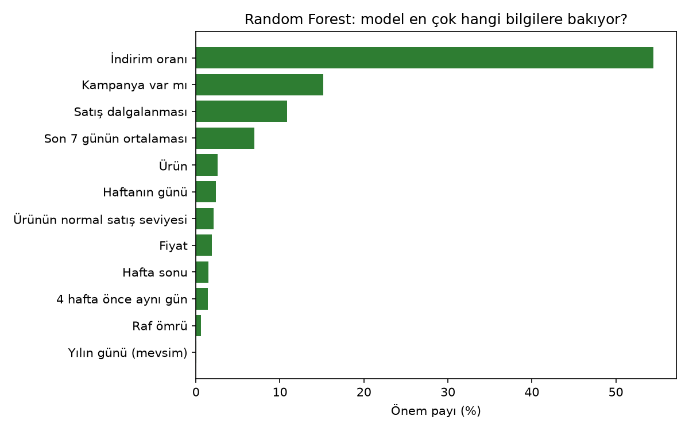

# Predictive Inventory

**SaaS-based smart stock and waste forecasting for SMEs** — graduation project.

Small shops usually order stock by habit, so perishable products are either thrown away or run out.
Predictive Inventory records a shop's stock movements and tells it, for each product:

- how much it will probably sell in the next 7 days,
- how many units to order now,
- how much of the current stock may expire unsold (waste risk).

Several companies can use the same installation; each company only sees its own data.

## Features

- **Products and stock movements:** stock in, sales and waste; current stock is calculated from the movements
- **Purchase price:** optional per product; the order suggestion uses the real profit margin
- **CSV import:** upload many movements at once from Excel, with row-by-row error messages
- **Promotions:** campaign days and discounts per product; forecasts raise sales on those days
- **Dashboard:** last 30 days of sales, revenue, waste rate and cost, low-stock products
- **Forecast page:** 7-day forecast, order suggestion and waste risk for each product, with the stock batches that may expire
- **Demo data:** one year of realistic data for "Demo Market" (17 products); the demo account is protected

## How it works

```
Browser ──> Laravel app (backend/) ──HTTP──> Python ML service (ml/)
             SQLite database  <── read-only ──  FastAPI + trained model
```

- The Python service reads the Laravel database (read-only) and predicts daily sales with a
  **Random Forest / Gradient Boosting** model, chosen by time-based validation against simple baselines.
- Features: past sales, weekday averages, calendar and holidays, promotion days and discount, shelf life, price.
- New products with little history get a simple average instead of the model.
- **Order suggestion** = expected sales until the next delivery + safety stock − current stock.
  The safety stock grows with the forecast error. For perishable products it balances the cost of
  waste against the lost profit of an empty shelf (newsvendor model), using the product's purchase
  price (or 60 % of the sales price if it is not entered), and an order never covers more days than
  the product's shelf life.
- **Waste risk** is calculated per batch: every stock-in is a batch that expires after the shelf life.
  Sales and waste are taken from the oldest batch first (FIFO), then the forecast is played forward
  day by day; whatever is left in a batch on its expiry day is at risk.

**Tech stack:** PHP 8.4, Laravel 13, Breeze, Tailwind CSS, SQLite · Python, pandas, scikit-learn, FastAPI

## Getting started

Requirements: PHP 8.4, Composer, Node.js, Python 3.10+.

**1. Laravel app**

```bash
cd backend
composer install
cp .env.example .env              # Windows: copy .env.example .env
php artisan key:generate
php artisan migrate --seed        # creates the database and loads the demo data
npm install && npm run build
php artisan serve                 # http://127.0.0.1:8000
```

Demo login: `demo@predictive-inventory.test` / `PiDemo-Stok-2026!` (set in `config/demo.php`, can be
changed in `.env` with `DEMO_EMAIL` and `DEMO_PASSWORD`). The login page has a button that fills these in;
it is only shown when `APP_ENV=local`.

**2. ML service** (second terminal)

```bash
cd ml
python -m venv .venv              # Windows: py -m venv .venv
source .venv/bin/activate         # Windows: .venv\Scripts\activate
pip install -r requirements.txt
uvicorn src.api:app --port 8001
```

**3. Train the model** (in `backend/`)

```bash
php artisan ml:train
```

This trains the model on the app's data and loads it into the running service.

**4. Run the tests**

```bash
cd backend && php artisan test   # Laravel
cd ml && python -m unittest      # Python
```

## Project structure

```
Predictive-Inventory/
├── backend/                         Laravel app
│   ├── app/
│   │   ├── Console/Commands/        ml:train command
│   │   ├── Http/Controllers/        pages: products, stock movements, CSV import, promotions, forecast, dashboard
│   │   ├── Models/                  Company, User, Product, StockMovement, Promotion
│   │   └── Services/                ForecastService (calls the ML service), MovementCsvImporter
│   ├── config/demo.php              demo account login
│   ├── database/
│   │   ├── migrations/              tables
│   │   └── seeders/DemoDataSeeder   one year of demo data
│   ├── resources/views/             Blade pages
│   └── tests/                       Laravel tests
└── ml/                              Python ML service
    ├── src/
    │   ├── api.py                   FastAPI endpoints
    │   ├── data.py                  reads the Laravel database (read-only)
    │   ├── features.py              features for the model
    │   ├── train.py                 trains and saves the model
    │   ├── predict.py               forecast, order suggestion, waste risk
    │   ├── decision.py              order quantity (safety stock, newsvendor)
    │   ├── batches.py               batch-based waste risk
    │   ├── backtest.py              ordering simulation
    │   └── report.py                charts
    ├── reports/                     results (CSV + charts)
    └── tests/                       Python tests
```

## CSV format

Stock movements can be uploaded from the stock movements page (**Dosyadan yükle**). A sample file can be downloaded there.

```
Tarih;Ürün;Tür;Miktar;Not
16.10.2026;SUT-001;Giriş;40;
16.10.2026;SUT-001;Satış;18;
16.10.2026;Ekmek;Fire;3;unsold
```

| Column | Meaning |
|---|---|
| `Tarih` | date: `16.10.2026` or `2026-10-16` (not in the future) |
| `Ürün` | product SKU or product name |
| `Tür` | `Giriş` / `Satış` / `Fire` (also `in` / `sale` / `waste`) |
| `Miktar` | positive number, decimals allowed (`1,5`) |
| `Not` | optional note |

- The first row is the header. `;` and `,` separators, UTF-8 and Turkish Windows (Excel) encoding are accepted.
- At most 5000 rows per file. If any row has an error, nothing is saved and the errors are listed row by row.

## API

**ML service** (`ml/`, http://127.0.0.1:8001, interactive docs at `/docs`). Only Laravel calls it.

| Method | Path | Returns |
|---|---|---|
| GET | `/health` | service status, loaded model and its metrics |
| GET | `/forecast/{product_id}` | 7-day daily sales forecast, method used, warnings |
| GET | `/order-suggestion/{product_id}?current_stock=` | suggested order, expected sales, safety stock, purchase price used |
| GET | `/waste-risk/{product_id}?current_stock=&shelf_life_days=` | units at risk, risk level, batches with expiry dates |
| POST | `/reload` | loads the newly trained model |

**Laravel pages** (login required; every page only shows the user's own company data)

| Path | Page |
|---|---|
| `/dashboard` | dashboard |
| `/products` | products (add, edit, delete) |
| `/products/{id}/forecast` | forecast, order suggestion, waste risk |
| `/stock-movements` | stock movements |
| `/stock-movements/import` | CSV import |
| `/promotions` | promotions |
| `/profile` | profile and password |

## Security notes

- **Company data is separated:** every query is limited to the user's company; opening another company's product returns 404.
- **The ML service listens only on 127.0.0.1.** It has no login of its own, so it must not be opened to the internet
  (do not start it with `--host 0.0.0.0`). It reads the database read-only.
- **Demo account:** it cannot be deleted and its name, e-mail and password cannot be changed or reset.
  The demo login box is only shown when `APP_ENV=local`.
- **Before putting the app online:** set `APP_ENV=production` and `APP_DEBUG=false` in `.env`
  (otherwise error pages show code and settings), use HTTPS, and change or remove the demo account.
- `.env` and the database file are not in the repository. GitHub Dependabot alerts are enabled for the dependencies.

## Results

Measured on the demo data with `ml/src/backtest.py` and `ml/src/report.py`
(numbers in [`ml/reports/`](ml/reports)).

**Forecast accuracy.** Error of 7-day-ahead forecasts, time-based validation (lower is better).
The ML models beat the simple rules a shop would use.


**Ordering simulation.** The last 180 days are replayed with the same sales, shelf lives and
delivery days; only the order quantity changes. Ordering with the forecast lowers the total cost
(waste + lost profit) compared with ordering by habit, and the ML forecast does better than a
simple average. The first rule of the app (7-day forecast + 20 %) is also in the table: it was far
too much for products that spoil in a few days, which is why it was replaced.


**What the model looks at.** Promotions, recent sales level and volatility matter most.



To reproduce (in `ml/`, after `php artisan ml:train`):

```bash
python -m src.backtest           # ordering simulation
python -m src.report             # model comparison and feature importance charts
python -m unittest               # automated tests
```

## Limitations

The demo data is synthetic, so results show that the system works, not how well it performs in a
real shop. If a product has no purchase price, it is assumed to be 60 % of the sales price.
Recorded sales are used as demand, so lost sales are underestimated on days when stock ran out.
Next step: validation on real sales data.

## Author

Yusuf Taha Çebi — graduation project, supervised by Dr. Sibel Boran.
