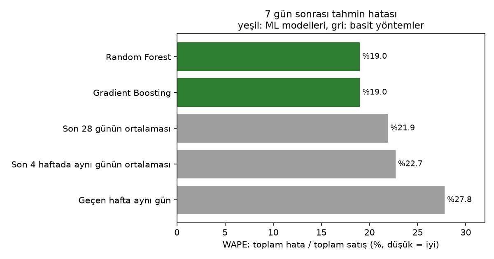
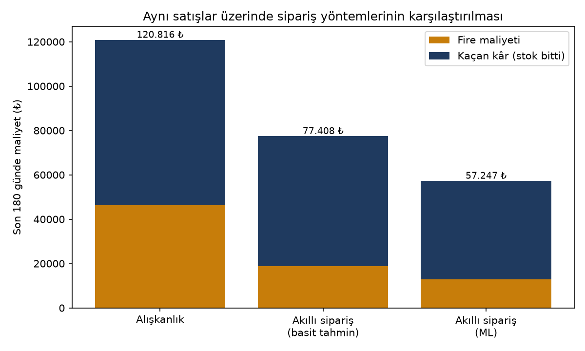

# Predictive Inventory

**SaaS-based smart stock and waste forecasting for SMEs** — graduation project.

Small shops order stock by habit, so perishable products are either thrown away or run out.
Predictive Inventory records stock movements and tells a shop, for each product, how much it will
sell in the next 7 days, how much to order now and how much of its stock may expire unsold.
Several companies can use one installation; each sees only its own data.

## Features

- Products, stock movements (in / sale / waste) and CSV import
- Promotions that raise the forecast on campaign days
- Dashboard: sales, revenue, waste rate, low-stock products
- Forecast page: 7-day forecast, order suggestion, waste risk per stock batch
- One year of demo data for "Demo Market" (17 products)

## How it works

```
Browser ──> Laravel (backend/) ──HTTP──> Python ML service (ml/)
            SQLite  <── read-only ──  FastAPI + Random Forest / Gradient Boosting
```

- **Order** = expected sales until the next delivery + safety stock − current stock.
  For perishables, waste cost is balanced against lost profit using the purchase price (newsvendor model).
- **Waste risk:** each stock-in is a batch; sales use the oldest batch first, and what is left on the expiry day is at risk.

**Stack:** PHP 8.4, Laravel 13, Tailwind, SQLite · Python, pandas, scikit-learn, FastAPI

## Getting started

```bash
# Laravel (backend/)
composer install && npm install && npm run build
cp .env.example .env && php artisan key:generate
php artisan migrate --seed
php artisan serve                     # http://127.0.0.1:8000

# ML service (ml/, second terminal)
python -m venv .venv && source .venv/bin/activate   # Windows: .venv\Scripts\activate
pip install -r requirements.txt
uvicorn src.api:app --port 8001

# Train the model (backend/)
php artisan ml:train
```

Demo login: `demo@predictive-inventory.test` / `PiDemo-Stok-2026!` (shown on the login page only when `APP_ENV=local`).

Tests: `php artisan test` (backend) and `python -m unittest` (ml).

## Results

Measured on the demo data (details in [`ml/reports/`](ml/reports)).

The ML models forecast better than the simple rules a shop would use:



Replaying the last 180 days, ordering with the forecast lowers waste + lost profit compared with ordering by habit:



## Project structure

```
backend/   Laravel app: controllers, models, ForecastService, CSV importer, demo seeder, tests
ml/src/    api.py (endpoints), predict.py, decision.py (order), batches.py (waste), train.py, backtest.py
ml/reports/  results and charts
```

**CSV import** (stock movements page): `Tarih;Ürün;Tür;Miktar;Not` — date, product SKU or name,
`Giriş` / `Satış` / `Fire`, quantity, optional note. A sample file can be downloaded in the app.

**ML API** (only called by Laravel, docs at http://127.0.0.1:8001/docs): `/forecast/{id}`,
`/order-suggestion/{id}`, `/waste-risk/{id}`, `/health`, `/reload`.

## Security notes

- Every query is limited to the user's company.
- The ML service has no login: keep it on 127.0.0.1, never `--host 0.0.0.0`.
- The demo account cannot be deleted or have its password changed.
- Before going online: `APP_ENV=production`, `APP_DEBUG=false`, HTTPS.

## Limitations

The demo data is synthetic, so the results show that the system works, not how it performs in a real shop.
Next step: validation on real sales data.

## Author

Yusuf Taha Çebi — graduation project, supervised by Dr. Sibel Boran.
